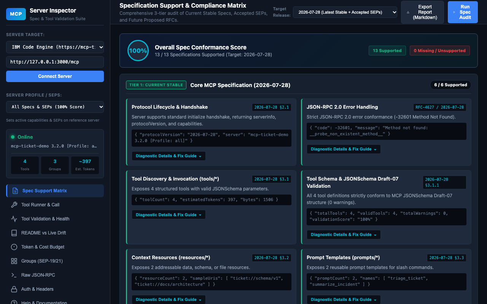
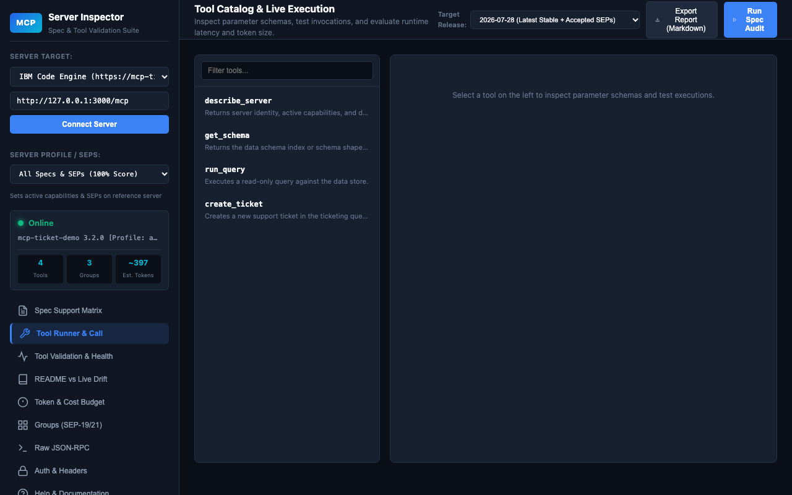
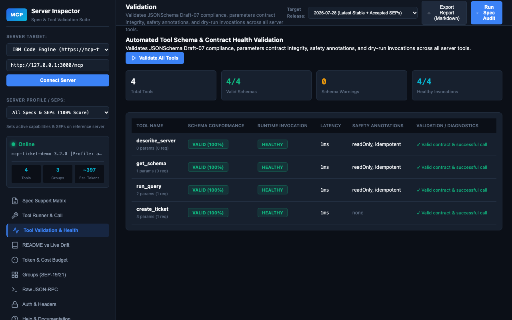
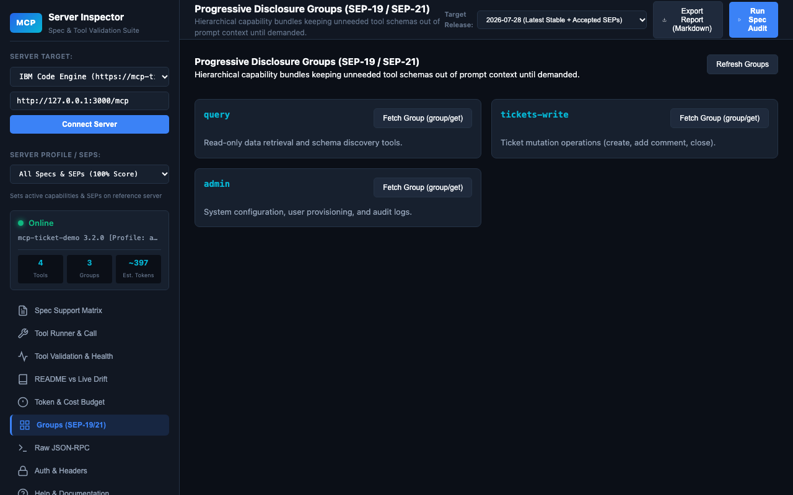
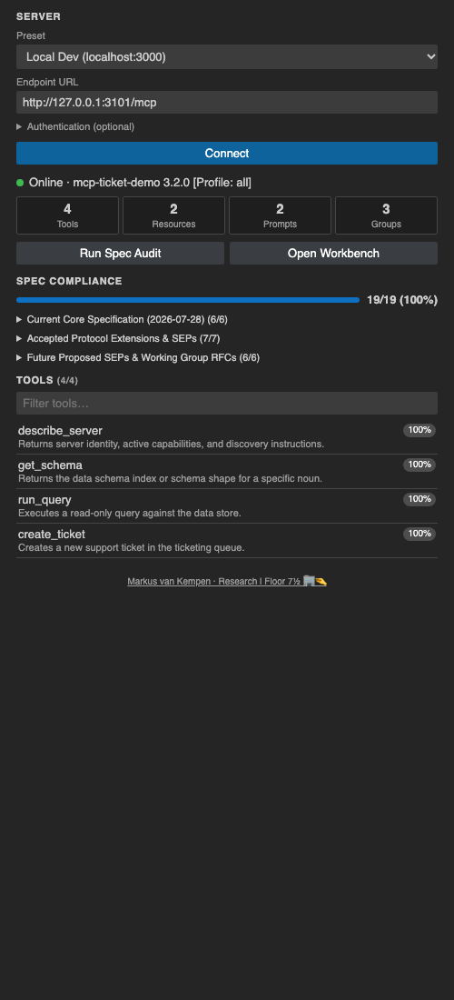

<div align="center">

# MCP Server Inspector & Spec Auditor

**A Manifest V3 Chrome extension and VS Code extension for exploring, validating, and auditing Model Context Protocol (MCP) servers.**

[](LICENSE)
[](#overview)
[](#overview)
[](#overview)
[](https://modelcontextprotocol.io)
[](https://www.jsonrpc.org/specification)
[](https://json-schema.org/draft-07)
[](#overview)
[](https://nodejs.org)
[](#overview)
[](PRIVACY.md)

[](https://github.com/markusvankempen/mcp-server-inspector-chrome-extention/stargazers)
[](https://github.com/markusvankempen/mcp-server-inspector-chrome-extention/network/members)
[](https://github.com/markusvankempen/mcp-server-inspector-chrome-extention/issues)
[](https://github.com/markusvankempen/mcp-server-inspector-chrome-extention/commits/main)
[](https://github.com/markusvankempen/mcp-server-inspector-chrome-extention)
[](https://github.com/markusvankempen/mcp-server-inspector-chrome-extention)
[](https://github.com/markusvankempen/mcp-server-inspector-chrome-extention/pulls)



</div>

**Author:** Markus van Kempen
[Research | Floor 7½ 🏢🤏](https://markusvankempen.github.io/)

**Topics:** `mcp` · `model-context-protocol` · `chrome-extension` · `vscode-extension` · `manifest-v3` · `inspector` · `json-rpc` · `jsonschema` · `spec-compliance` · `llm-tools` · `ai-agents` · `developer-tools` · `devtools` · `sse` · `streamable-http`

---

## Table of Contents

- [Overview](#overview)
- [Features](#features)
- [Screenshots](#screenshots)
- [Codebase Architecture & File Directory](#codebase-architecture--file-directory)
- [Detailed API & Function Reference](#detailed-api--function-reference)
- [Chrome Web Store Submission Package](#chrome-web-store-submission-package)
- [Source Code & Access](#source-code--access)
- [Privacy](#privacy)
- [License](#license)

---

## Overview

The **MCP Server Inspector & Spec Auditor** is built for developers, AI engineers, and tool authors building and integrating Model Context Protocol servers. It provides automated specification compliance testing, deep JSONSchema Draft-07 validation on tool contracts, runtime health dry-runs, latency/token budgeting, and progressive disclosure group exploration.

---

## Features

- **3-tier specification audit** with a 0–100% compliance score, covering lifecycle, JSON-RPC errors, tools, resources, prompts, and SEP extensions.
- **JSONSchema Draft-07 validation** of every tool contract, plus SEP-1850 safety annotation checks.
- **Dynamic tool runner** that builds type-safe forms from tool schemas and measures latency and token size.
- **Batch dry-run tests** across all tools with schema health scoring.
- **README drift analyzer** comparing GitHub README claims against live server discovery.
- **Progressive disclosure groups explorer** (`group/list`, `group/get`) with token-savings estimates.
- **Raw JSON-RPC console** with templates; Streamable HTTP and SSE support.
- **Zero runtime dependencies**, no telemetry; settings are stored locally in `chrome.storage.local`.

---

## Screenshots

| Tool runner | Batch validation |
|---|---|
|  |  |
| **README drift** | **Groups explorer** |
|  |  |
| **VS Code side panel** | |
|  | |

---

## Codebase Architecture & File Directory

```
mcp-server-inspector-chrome-extention/
├── src/                       # Chrome extension (load THIS folder as "unpacked")
│   ├── manifest.json          # Manifest V3 configuration
│   ├── background.js          # Service worker (opens the full-tab workbench)
│   ├── workbench/             # Full-screen developer workbench
│   │   ├── index.html
│   │   ├── app.js             # Main controller & UI orchestration
│   │   └── app.css
│   ├── popup/                 # Compact toolbar popup
│   │   ├── popup.html
│   │   ├── popup.js
│   │   └── popup.css
│   ├── lib/                   # Shared protocol logic
│   │   ├── mcp-client.js      # JSON-RPC 2.0 / Streamable HTTP client & token estimator
│   │   └── spec-tester.js     # Automated 3-tier specification & tool validation engine
│   ├── pages/
│   │   └── privacy.html       # Extension privacy policy page
│   └── icons/                 # Extension icons (16, 32, 48, 128 px)
├── vscode-extension/          # VS Code extension (same workbench UI in a webview)
│   ├── package.json           # Extension manifest (command, settings)
│   ├── extension.js           # Extension host: webview, HTTP, SecretStorage
│   ├── media/                 # host-shim.js (webview <-> host bridge), sidebar.{html,css,js} (Activity Bar panel), icons
│   └── webview/               # Generated: copy of src/workbench + src/lib (git-ignored)
├── test/                      # Test tooling
│   ├── test-local-server.js   # Mock MCP server with full SEP support (+ static host for src/)
│   ├── run-test-suite.js      # Headless automated CLI verification runner
│   ├── vscode-extension-tests.js # VS Code host, CSP and shim tests
│   └── misc-tests.js          # Protocol edge-case & schema tests
├── tools/                     # Build & asset generation scripts
│   ├── build-dist.js          # Packages src/ into dist/ (zip + unpacked)
│   ├── build-vscode.js        # Stages shared UI and packages the .vsix
│   ├── generate-icons.js      # Renders extension icons
│   └── generate-screenshots.js# Renders store screenshots & promo tiles
├── store/                     # Chrome Web Store listing copy, screenshots, promo tiles
├── dist/                      # Build output (generated)
├── PRIVACY.md                 # Privacy policy documentation
├── package.json               # NPM scripts and metadata
└── mise.toml                  # Mise tool/task configuration
```

---

## Detailed API & Function Reference

### 1. `McpClient` (`src/lib/mcp-client.js`)
Handles JSON-RPC 2.0 over Streamable HTTP / POST, Server-Sent Events (SSE), and extension capability negotiation.

| Function / Method | Parameters | Return Type | Description |
|---|---|---|---|
| `constructor(options)` | `options: Object` | `McpClient` | Initializes client with endpoint, custom headers, session ID, target protocol version, and declared capabilities. |
| `setEndpoint(url)` | `url: string` | `void` | Updates the target MCP server endpoint URL. |
| `setHeaders(headers)` | `headers: Object` | `void` | Updates HTTP headers applied to outbound requests (Auth, API keys, session IDs). |
| `estimateTokens(payload)` *(static)* | `payload: string \| Object` | `{ bytes, tokens, chars }` | Calculates estimated token consumption and byte weight (~3.8–4 bytes/token heuristic). |
| `request(method, params, options)` | `method: string, params: Object, options: Object` | `Promise<{ result, _meta, duration, metrics, raw }>` | Sends JSON-RPC 2.0 HTTP POST request, handles SSE frames, extracts session IDs, and parses `_meta`. |
| `initialize()` | *none* | `Promise<Object>` | Performs protocol lifecycle handshake (`initialize`), captures server capabilities, and sends `notifications/initialized`. |
| `notify(method, params)` | `method: string, params: Object` | `Promise<void>` | Sends a one-way notification to the server without expecting a response. |
| `listTools(cursor)` | `cursor?: string` | `Promise<Object>` | Retrieves tool definitions and schemas via `tools/list`. |
| `callTool(name, args, meta)` | `name: string, args: Object, meta: Object` | `Promise<Object>` | Invokes a specific tool via `tools/call` with arguments and optional `_meta` capabilities. |
| `listResources(cursor)` | `cursor?: string` | `Promise<Object>` | Discovers context data and file resources via `resources/list`. |
| `readResource(uri)` | `uri: string` | `Promise<Object>` | Reads resource content by URI via `resources/read`. |
| `listPrompts(cursor)` | `cursor?: string` | `Promise<Object>` | Discovers prompt templates via `prompts/list`. |
| `listGroups(cursor)` | `cursor?: string` | `Promise<Object>` | Discovers progressive disclosure capability groups (`group/list` with fallback to `groups/list`). |
| `getGroup(name)` | `name: string` | `Promise<Object>` | Retrieves scoped tool definitions and instructions for a group via `group/get`. |
| `listTasks(cursor)` | `cursor?: string` | `Promise<Object>` | Lists asynchronous tasks via `tasks/list`. |
| `getTask(taskId)` | `taskId: string` | `Promise<Object>` | Fetches task status and result via `tasks/get`. |
| `streamTask(taskId, after)` | `taskId: string, after?: number` | `Promise<Object>` | Streams task events with cursor resume support via `tasks/stream`. |
| `getServerCard()` | *none* | `Promise<Object>` | Fetches server pre-connection metadata card via `server/card` (SEP-2127). |
| `listSkills(cursor)` | `cursor?: string` | `Promise<Object>` | Lists compound agentic skill workflows via `skills/list` (SEP-2640). |
| `getSkill(name)` | `name: string` | `Promise<Object>` | Fetches skill manifest and steps via `skills/get` (SEP-2640). |

---

### 2. `SpecTester` (`src/lib/spec-tester.js`)
Automated specification compliance and tool contract validation engine.

| Function / Method | Parameters | Return Type | Description |
|---|---|---|---|
| `constructor(client)` | `client: McpClient` | `SpecTester` | Initializes tester instance with target client and 3-tier result structures. |
| `validateToolSchema(tool)` *(static)* | `tool: Object` | `{ valid, score, errors, warnings, details }` | Deeply audits a tool definition against MCP JSONSchema Draft-07 specs and SEP-1850 safety hints. |
| `runFullAudit(targetVersion)` | `targetVersion: string` | `Promise<Object>` | Runs comprehensive 3-tier probe suite and computes 0–100% compliance score. |
| `addSpecResult(...)` | `tierKey, specKey, title, refId, status, details, summaryOrReason, impact, refUrl` | `Object` | Formats and appends an individual specification compliance result to a tier. |
| `logResult(...)` | `category, testName, status, details, advice` | `Object` | Records diagnostic probe trace entry. |
| `auditInitialize()` | *none* | `Promise<void>` | Tests protocol handshake (`initialize`) and capabilities negotiation (2026-07-28 §2.1). |
| `auditJsonRpc()` | *none* | `Promise<void>` | Verifies strict `-32601 Method Not Found` JSON-RPC 2.0 error handling. |
| `auditTools()` | *none* | `Promise<Array>` | Evaluates `tools/list` endpoint and schema declarations. |
| `auditToolSchemaCompliance(tools)` | `tools: Array` | `Promise<void>` | Audits JSONSchema Draft-07 compliance across all server tools. |
| `auditResources()` | *none* | `Promise<void>` | Audits `resources/list` context resources support. |
| `auditPrompts()` | *none* | `Promise<void>` | Audits `prompts/list` reusable prompt template support. |
| `auditToolAnnotations(tools)` | `tools: Array` | `Promise<void>` | Audits tool safety annotations (`readOnlyHint`, `idempotentHint`, `openWorldHint` — SEP-1850). |
| `auditRootsSupport()` | *none* | `Promise<void>` | Audits workspace roots and filesystem boundary support (SEP-2636). |
| `auditSamplingSupport()` | *none* | `Promise<void>` | Audits server-initiated LLM sampling support (SEP-1577). |
| `auditCatalogAndQueryPattern(tools)`| `tools: Array` | `Promise<void>` | Audits implementation of Catalog + Query pattern (`describe_server`, `get_schema`, `run_query`). |
| `auditServerCard()` | *none* | `Promise<void>` | Audits Server Card discovery metadata (SEP-2127). |
| `auditTtlCaching()` | *none* | `Promise<void>` | Audits response TTL caching hints on list results (SEP-2549). |
| `auditResourceNotFound()` | *none* | `Promise<void>` | Audits standardized `-32002 Resource Not Found` error code (SEP-2164). |
| `auditProgressiveDisclosureGroups()`| *none* | `Promise<void>` | Audits progressive disclosure groups (`group/list`, `group/get` — SEP-19 / SEP-21). |
| `auditToolFailureClassification()` | *none* | `Promise<void>` | Audits structured error classification (`_meta["io.modelcontextprotocol/toolFailure"]` — SEP-3313). |
| `auditTasksAndStreaming()` | *none* | `Promise<void>` | Audits resumable tasks and cursor streams (SEP-2663 / SEP-2694). |
| `auditSkillsExtension()` | *none* | `Promise<void>` | Audits compound agentic skills extension (SEP-2640). |
| `auditElicitationSupport()` | *none* | `Promise<void>` | Audits URL mode elicitation and user consent support (SEP-1036). |
| `auditEventsAndWebhooks()` | *none* | `Promise<void>` | Audits push events and webhook notifications (SEP-3415). |
| `testAllTools()` | *none* | `Promise<Array>` | Executes automated batch dry-run tests and schema scoring across all server tools. |
| `analyzeReadmeDrift(readmeText, liveState)` | `readmeText: string, liveState: Object` | `Object` | Compares README.md documentation claims against runtime server discovery. |
| `exportMarkdown(report)` *(static)* | `report: Object` | `string` | Formats full audit findings into GitHub-flavored Markdown. |

---

### 3. Workbench UI Controller (`src/workbench/app.js`)

| Function | Description |
|---|---|
| `loadStoredConfig()` | Restores persisted endpoints, API keys, and custom headers from `chrome.storage.local`. |
| `buildHeaders()` | Synchronizes header input fields into active request headers for `McpClient`. |
| `setupEventListeners()` | Registers tab switching, preset dropdowns, and button click handlers. |
| `updateHeadings(tabId)` | Updates the top navbar title and subtitle dynamically per active tab. |
| `connectServer(url)` | Performs handshake, loads tool catalogs, and updates sidebar status indicator. |
| `updateStatusIndicator(text, state)` | Updates visual status badge (Online, Connecting, Error). |
| `fetchTools()` / `fetchGroups()` / `fetchResources()` / `fetchPrompts()` | Fetches server primitives and updates UI grids. |
| `runSpecAudit()` / `renderSpecMatrix(report)` / `renderTierSection(...)` | Orchestrates 3-tier audit execution and renders compliance cards. |
| `exportAuditReport()` | Exports report to clipboard or downloads `.md` file. |
| `renderToolsList(tools)` / `filterTools(query)` / `selectTool(tool, element)` | Manages tool catalog sidebar and selection. |
| `renderToolSchemaValidationBox(validation)` | Renders schema health score, parameter counts, errors, and warnings. |
| `buildDynamicForm(schema)` / `getFormValues()` / `syncFormToJson()` | Dynamically generates type-safe input form controls from JSONSchema definitions. |
| `executeSelectedTool()` | Invokes `tools/call`, timing latency, token size, and classified failures. |
| `runBatchToolTests()` | Executes automated batch dry-run validation table across all tools. |
| `fetchGitHubReadme()` / `runReadmeDriftAnalysis()` | Fetches GitHub README and executes drift comparison. |
| `calculateTokenBreakdown()` | Calculates token usage per tool and estimates progressive disclosure token savings. |
| `renderGroupsView(groups)` / `fetchAndExpandGroup(name, el)` | Renders progressive disclosure groups explorer and retrieves scoped tools via `group/get`. |
| `loadRpcTemplate(method)` / `sendRawRpc()` | Provides raw JSON-RPC console with pre-configured templates. |
| `saveAuthSettings()` | Persists authentication headers to Chrome local storage. |
| `escapeHtml(str)` | Sanitizes user strings to prevent XSS injection. |

---

## Chrome Web Store Submission Package

The complete submission package is located in [`store/LISTING.txt`](store/LISTING.txt).

### Store Metadata Summary:
- **Extension Name:** MCP Server Inspector & Spec Auditor
- **Short Description:** Developer workbench for testing Model Context Protocol (MCP) servers, tool JSONSchemas, SEPs, latency, and progressive disclosure. (128 characters)
- **Category:** Developer Tools
- **Permissions:** `storage`, `unlimitedStorage`, `declarativeNetRequestWithHostAccess`, `host_permissions: [localhost, 127.0.0.1, demo server]`, `optional_host_permissions: ["http://*/*", "https://*/*"]` (requested per server at runtime)
- **Images Required:**
  - `screenshot-1-spec-matrix.png` (1280×800)
  - `screenshot-2-tools-runner.png` (1280×800)
  - `screenshot-3-batch-validation.png` (1280×800)
  - `screenshot-4-readme-drift.png` (1280×800)
  - `screenshot-5-groups-explorer.png` (1280×800)
  - `promo-small-440x280.png` (440×280)
  - `promo-marquee-1400x560.png` (1400×560)

---

## Source Code & Access

This repository contains **documentation only** (README, privacy policy, store listing copy and screenshots). The Chrome and VS Code extension source code is maintained in a private repository.

---

## Privacy

No telemetry or analytics. See [`PRIVACY.md`](PRIVACY.md).

---

## License

Licensed under the **Apache 2.0 License**.
