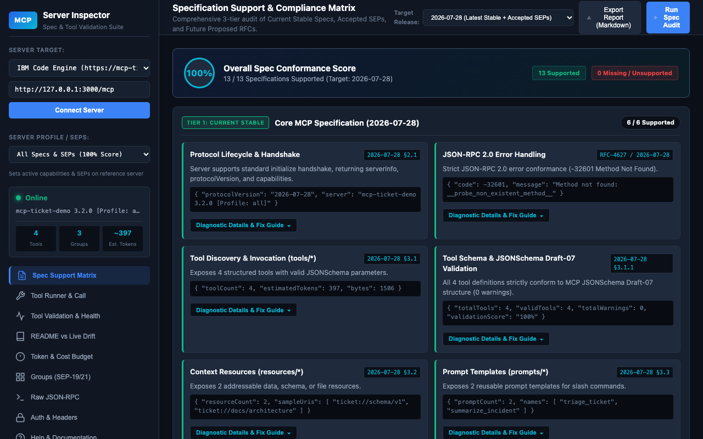
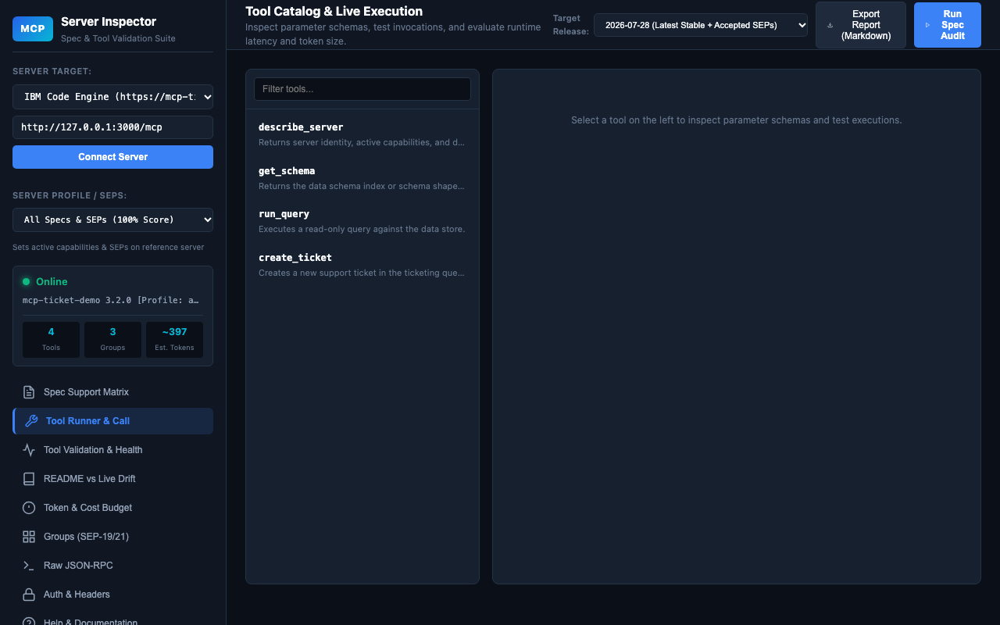
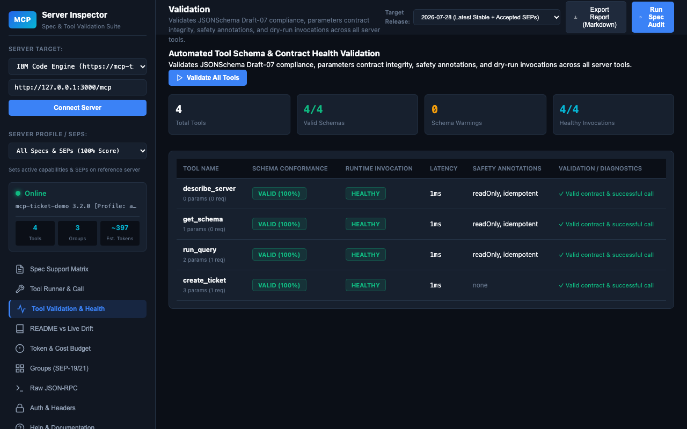
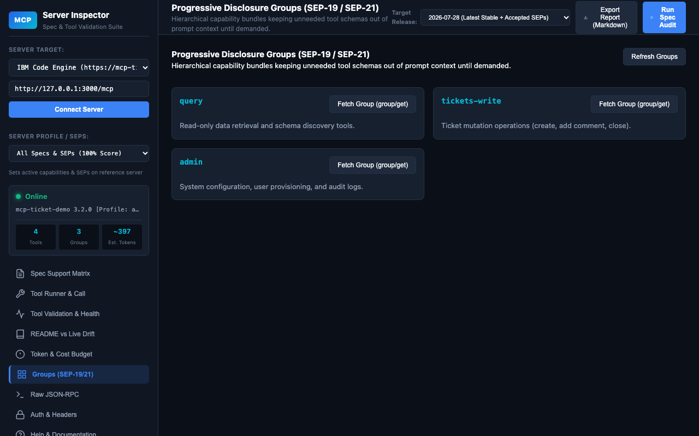
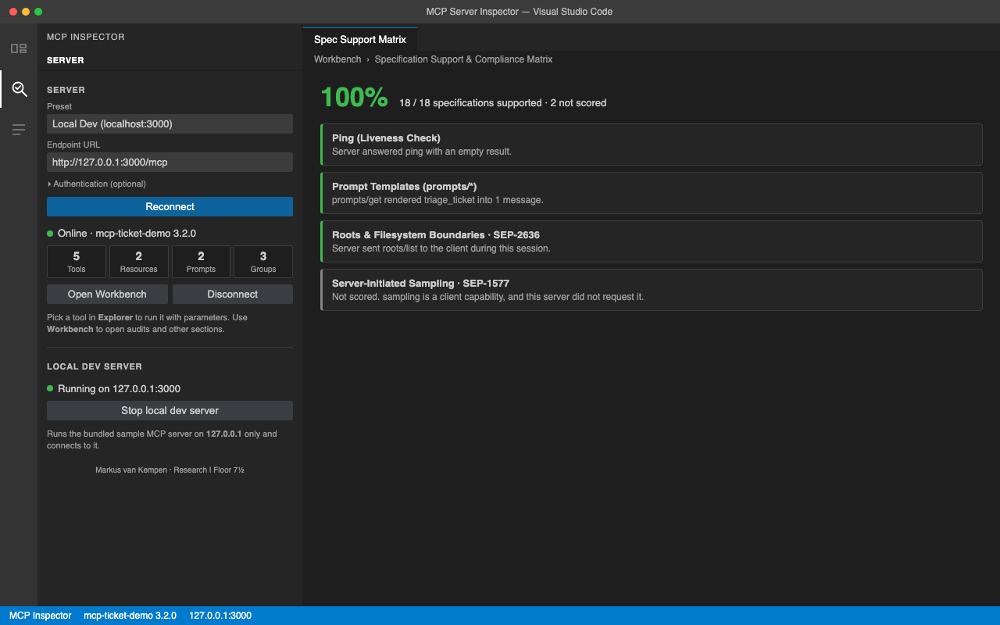

<div align="center">

# MCP Server Inspector & Spec Auditor

**A Manifest V3 Chrome extension and VS Code extension for exploring, validating, and auditing Model Context Protocol (MCP) servers.**

[](LICENSE)
[](src/manifest.json)
[](src/manifest.json)
[](vscode-extension)
[](https://modelcontextprotocol.io)
[](https://www.jsonrpc.org/specification)
[](https://json-schema.org/draft-07)
[](package.json)
[](https://nodejs.org)
[](package.json)
[](PRIVACY.md)

[](https://marketplace.visualstudio.com/items?itemName=markusvankempen.mcp-server-inspector-auditor)
[](https://marketplace.visualstudio.com/items?itemName=markusvankempen.mcp-server-inspector-auditor)
[](https://open-vsx.org/extension/markusvankempen/mcp-server-inspector-auditor)
[](#features)
[](#features)
[](#features)
[](#features)
[](#features)
[](#quick-start--automated-testing)
[](#installing-into-google-chrome)
[](vscode-extension/CHANGELOG.md)
[](https://www.ibm.com)

[](https://github.com/markusvankempen/mcp-server-inspector-chrome-extension/stargazers)
[](https://github.com/markusvankempen/mcp-server-inspector-chrome-extension/network/members)
[](https://github.com/markusvankempen/mcp-server-inspector-chrome-extension/issues)
[](https://github.com/markusvankempen/mcp-server-inspector-chrome-extension/commits/main)
[](https://github.com/markusvankempen/mcp-server-inspector-chrome-extension)
[](https://github.com/markusvankempen/mcp-server-inspector-chrome-extension)
[](https://github.com/markusvankempen/mcp-server-inspector-chrome-extension/pulls)



</div>

**Author:** Markus van Kempen
[Research | Floor 7½ 🏢🤏](https://markusvankempen.github.io/)

**Topics:** `mcp` · `model-context-protocol` · `chrome-extension` · `vscode-extension` · `manifest-v3` · `inspector` · `json-rpc` · `jsonschema` · `spec-compliance` · `llm-tools` · `ai-agents` · `developer-tools` · `devtools` · `sse` · `streamable-http` · `security` · `prompt-injection` · `tool-poisoning` · `post-quantum` · `tls` · `cbom` · `cyclonedx` · `owasp` · `audit` · `linter` · `conformance-testing` · `mcp-server` · `mcp-client` · `ai-security`

---

## Table of Contents

- [Overview](#overview)
- [Features](#features)
- [Screenshots](#screenshots)
- [Codebase Architecture & File Directory](#codebase-architecture--file-directory)
- [Detailed API & Function Reference](#detailed-api--function-reference)
- [Chrome Web Store Submission Package](#chrome-web-store-submission-package)
- [Quick Start & Automated Testing](#quick-start--automated-testing)
- [Installing into Google Chrome](#installing-into-google-chrome)
- [VS Code Extension](#vs-code-extension)
- [Privacy](#privacy)
- [License](#license)

---

## Overview

The **MCP Server Inspector & Spec Auditor** is built for developers, AI engineers, and tool authors building and integrating Model Context Protocol servers. It provides automated specification compliance testing, deep JSONSchema Draft-07 validation on tool contracts, runtime health dry-runs, latency/token budgeting, and progressive disclosure group exploration.

---

## Features

- **3-tier specification audit** with a 0–100% compliance score, covering lifecycle, JSON-RPC errors, tools, resources, prompts, and SEP extensions.
- **JSONSchema Draft-07 validation** of every tool contract, plus SEP-1850 safety annotation checks.
- **Dynamic tool runner** that builds type-safe forms from tool schemas and measures latency and token size.
- **Batch dry-run tests** across all tools with schema health scoring.
- **README drift analyzer** comparing GitHub README claims against live server discovery.
- **Progressive disclosure groups explorer** (`group/list`, `group/get`) with token-savings estimates.
- **Raw JSON-RPC console** with templates; Streamable HTTP and SSE support.
- **Tier 4: Transport & Crypto Posture** (black-box, no code scanning) with its own score, kept out of the spec score: scheme, TLS version, cipher suite, key-exchange group (hybrid post-quantum `X25519MLKEM768` vs classical), certificate and the JWT algorithm of your Bearer token (header only; the token is never shown or stored). Findings use three levels: *broken now*, *quantum-vulnerable (advisory)* and *quantum-ready*. Includes a CycloneDX CBOM fragment export. The TLS handshake checks need the VS Code edition (browsers cannot read TLS details); the Chrome extension reports them as "unknown". Loopback endpoints are skipped, and the report notes that a CDN or proxy's TLS is what you observe for proxied endpoints.
- **Tier 5: Security Hygiene** (black-box heuristics, no code scanning) with its own score, kept out of the spec score. It scans every tool name, title, description and parameter doc for hidden or bidirectional Unicode characters, injection-style wording ("ignore previous instructions", "do not tell the user"), references to credential files, long encoded blobs, oversized descriptions, duplicate or malformed names and destructive-looking tools without safety hints. A **tool fingerprint** (SHA-256 per tool, stored locally per endpoint) reports when descriptions, schemas or annotations change after you accepted them (the "rug pull"). **Active probes are opt-in** (checkbox, off by default) and cover unauthenticated access, Origin validation (VS Code edition only), OAuth protected-resource discovery, HSTS, CORS, server banners, error-message leakage and session-ID quality. Pattern checks are heuristics: a clean report is not a guarantee.
- **Zero runtime dependencies**, no telemetry; settings are stored locally in `chrome.storage.local`.

---

## Screenshots

| Tool runner | Batch validation |
|---|---|
|  |  |
| **README drift** | **Groups explorer** |
|  |  |
| **VS Code Server view** | |
|  | |

---

## Codebase Architecture & File Directory

```
mcp-server-inspector-chrome-extension/
├── src/                       # Chrome extension (load THIS folder as "unpacked")
│   ├── manifest.json          # Manifest V3 configuration
│   ├── background.js          # Service worker (opens the full-tab workbench)
│   ├── workbench/             # Full-screen developer workbench
│   │   ├── index.html
│   │   ├── app.js             # Main controller & UI orchestration
│   │   └── app.css
│   ├── popup/                 # Compact toolbar popup
│   │   ├── popup.html
│   │   ├── popup.js
│   │   └── popup.css
│   ├── lib/                   # Shared protocol logic
│   │   ├── mcp-client.js      # JSON-RPC 2.0 / Streamable HTTP client & token estimator
│   │   ├── crypto-posture.js  # Tier 4 crypto posture evaluation, JWT header check, CBOM fragment
│   │   ├── security-hygiene.js# Tier 5 tool-metadata scan, fingerprint (rug-pull) diff, opt-in probes
│   │   ├── host-access.js     # Requests optional host permission per server origin at runtime
│   │   └── spec-tester.js     # Automated 3-tier specification & tool validation engine
│   ├── pages/
│   │   └── privacy.html       # Extension privacy policy page
│   └── icons/                 # Extension icons (16, 32, 48, 128 px)
├── vscode-extension/          # VS Code extension (same workbench UI in a webview)
│   ├── package.json           # Extension manifest (views, commands, menus, settings)
│   ├── extension.js           # Extension host: webviews, HTTP, SecretStorage, tool runner
│   ├── session.js             # Shared MCP connection (uses the shared client)
│   ├── views.js               # Explorer + Workbench navigation tree views
│   ├── tool-args.js           # Schema -> JSONC argument template, JSONC parsing
│   ├── tls-probe.js           # TLS handshake probe for the crypto posture audit (node:tls only)
│   ├── media/                 # host-shim.js (webview <-> host bridge), sidebar.{html,css,js} (Server view), icons
│   ├── webview/               # Generated: copy of src/workbench + src/lib (git-ignored)
│   └── dev-server/            # Generated: bundled copy of the mock server for the local dev server (git-ignored)
├── test/                      # Test tooling
│   ├── test-local-server.js   # Mock MCP server with full SEP support (+ static host for src/)
│   ├── run-test-suite.js      # Headless automated CLI verification runner
│   ├── vscode-extension-tests.js # VS Code host, CSP and shim tests
│   ├── crypto-posture-tests.js   # Crypto posture logic + TLS probe against local TLS servers
│   ├── security-hygiene-tests.js # Hygiene scan, fingerprint and probe tests against local servers
│   └── misc-tests.js          # Protocol edge-case & schema tests
├── tools/                     # Build & asset generation scripts
│   ├── build-dist.js          # Packages src/ into dist/ (zip + unpacked)
│   ├── build-vscode.js        # Stages shared UI and packages the .vsix
│   ├── generate-icons.js      # Renders extension icons
│   └── generate-screenshots.js# Renders store screenshots & promo tiles
├── store/                     # Chrome Web Store listing copy, screenshots, promo tiles
├── dist/                      # Build output (generated)
├── PRIVACY.md                 # Privacy policy documentation
├── package.json               # NPM scripts and metadata
└── mise.toml                  # Mise tool/task configuration
```

---

## Detailed API & Function Reference

### 1. `McpClient` (`src/lib/mcp-client.js`)
Handles JSON-RPC 2.0 over Streamable HTTP / POST, Server-Sent Events (SSE), and extension capability negotiation.

| Function / Method | Parameters | Return Type | Description |
|---|---|---|---|
| `constructor(options)` | `options: Object` | `McpClient` | Initializes client with endpoint, custom headers, session ID, target protocol version, and declared capabilities. |
| `setEndpoint(url)` | `url: string` | `void` | Updates the target MCP server endpoint URL. |
| `setHeaders(headers)` | `headers: Object` | `void` | Updates HTTP headers applied to outbound requests (Auth, API keys, session IDs). |
| `estimateTokens(payload)` *(static)* | `payload: string \| Object` | `{ bytes, tokens, chars }` | Calculates estimated token consumption and byte weight (~3.8–4 bytes/token heuristic). |
| `request(method, params, options)` | `method: string, params: Object, options: Object` | `Promise<{ result, _meta, duration, metrics, raw, notifications, serverRequests }>` | Sends a JSON-RPC 2.0 POST. SSE responses are read event by event: notifications and server-to-client requests that arrive before the response are collected, and server requests are answered while the stream is open. |
| `buildRequestHeaders()` | *none* | `Object` | Headers for every POST: custom headers, `Mcp-Session-Id`, and `MCP-Protocol-Version` once `initialize` has negotiated a version. |
| `parseSseEvents(text)` / `createSseParser(onEvent)` *(static)* | `text: string` / `onEvent: (data) => void` | `string[]` / parser | Splits Server-Sent Events into data payloads, either from complete text or incrementally from a stream. |
| `initialize()` | *none* | `Promise<Object>` | Performs protocol lifecycle handshake (`initialize`), records the negotiated protocol version and server capabilities, and sends `notifications/initialized`. |
| `notify(method, params)` | `method: string, params: Object` | `Promise<void>` | Sends a one-way notification to the server without expecting a response. |
| `ping()` | *none* | `Promise<Object>` | Liveness check via `ping`; the result should be `{}`. |
| `listAllPages(method, key, maxPages)` | `method: string, key: string, maxPages?: number` | `Promise<Object>` | Follows `nextCursor` across pages and merges `result[key]`; reports `pages` and `truncated`. |
| `listTools(cursor)` | `cursor?: string` | `Promise<Object>` | Retrieves tool definitions via `tools/list`. Without a cursor, all pages are fetched. |
| `callTool(name, args, meta)` | `name: string, args: Object, meta: Object` | `Promise<Object>` | Invokes a specific tool via `tools/call` with arguments and optional `_meta` capabilities. |
| `listResources(cursor)` | `cursor?: string` | `Promise<Object>` | Discovers context data and file resources via `resources/list`. Without a cursor, all pages are fetched. |
| `readResource(uri)` | `uri: string` | `Promise<Object>` | Reads resource content by URI via `resources/read`. |
| `listPrompts(cursor)` | `cursor?: string` | `Promise<Object>` | Discovers prompt templates via `prompts/list`. Without a cursor, all pages are fetched. |
| `getPrompt(name, args)` | `name: string, args?: Object` | `Promise<Object>` | Renders a prompt template into messages via `prompts/get`. |
| `listGroups(cursor)` | `cursor?: string` | `Promise<Object>` | Discovers progressive disclosure capability groups (`groups/list` with fallback to `group/list`). |
| `getGroup(name)` | `name: string` | `Promise<Object>` | Retrieves scoped tool definitions and instructions for a group (`groups/get` with fallback to `group/get`). |
| `listTasks(cursor)` | `cursor?: string` | `Promise<Object>` | Lists asynchronous tasks via `tasks/list`. |
| `getTask(taskId)` | `taskId: string` | `Promise<Object>` | Fetches task status and result via `tasks/get`. |
| `streamTask(taskId, after)` | `taskId: string, after?: number` | `Promise<Object>` | Streams task events with cursor resume support via `tasks/stream`. |
| `getServerCard()` | *none* | `Promise<Object>` | Fetches server pre-connection metadata card via `server/card` (SEP-2127). |
| `listSkills(cursor)` | `cursor?: string` | `Promise<Object>` | Lists compound agentic skill workflows via `skills/list` (SEP-2640). |
| `getSkill(name)` | `name: string` | `Promise<Object>` | Fetches skill manifest and steps via `skills/get` (SEP-2640). |

**Client capabilities.** By default the client declares only `roots` and answers `roots/list` with `options.roots` (empty by default). It answers a server's `ping` with `{}` and replies `-32601` to any other server request (such as `sampling/createMessage` or `elicitation/create`), so the server is never left waiting. The `onMessage` option receives every server notification and request, and `serverRequestCounts` tallies the requests per method.

---

### 2. `SpecTester` (`src/lib/spec-tester.js`)
Automated specification compliance and tool contract validation engine.

| Function / Method | Parameters | Return Type | Description |
|---|---|---|---|
| `constructor(client)` | `client: McpClient` | `SpecTester` | Initializes tester instance with target client and 3-tier result structures. |
| `validateToolSchema(tool)` *(static)* | `tool: Object` | `{ valid, score, errors, warnings, details }` | Deeply audits a tool definition against MCP JSONSchema Draft-07 specs and SEP-1850 safety hints. |
| `runFullAudit(targetVersion)` | `targetVersion: string` | `Promise<Object>` | Runs comprehensive 3-tier probe suite and computes 0–100% compliance score over SUPPORTED and UNSUPPORTED results; INFO results are listed in `informational` and not scored. |
| `addSpecResult(...)` | `tierKey, specKey, title, refId, status, details, summaryOrReason, impact, refUrl` | `Object` | Formats and appends an individual specification compliance result (`SUPPORTED`, `UNSUPPORTED` or `INFO`) to a tier. |
| `auditPing()` | *none* | `Promise<void>` | Checks that `ping` is answered with an empty result. |
| `auditClientFeature(spec)` | `spec: Object` | `void` | Reports a client capability (roots, sampling, elicitation): SUPPORTED when the server was seen sending the matching request, otherwise INFO. |
| `logResult(...)` | `category, testName, status, details, advice` | `Object` | Records diagnostic probe trace entry. |
| `auditInitialize()` | *none* | `Promise<void>` | Tests protocol handshake (`initialize`) and capabilities negotiation (2026-07-28 §2.1). |
| `auditJsonRpc()` | *none* | `Promise<void>` | Verifies strict `-32601 Method Not Found` JSON-RPC 2.0 error handling. |
| `auditTools()` | *none* | `Promise<Array>` | Evaluates `tools/list` endpoint and schema declarations. |
| `auditToolSchemaCompliance(tools)` | `tools: Array` | `Promise<void>` | Audits JSONSchema Draft-07 compliance across all server tools. |
| `auditResources()` | *none* | `Promise<void>` | Audits `resources/list` context resources support. |
| `auditPrompts()` | *none* | `Promise<void>` | Audits `prompts/list` and renders the first prompt with `prompts/get`. |
| `auditToolAnnotations(tools)` | `tools: Array` | `Promise<void>` | Audits tool safety annotations (`readOnlyHint`, `idempotentHint`, `openWorldHint` — SEP-1850). |
| `auditRootsSupport()` | *none* | `Promise<void>` | Reports whether the server requested `roots/list` from the client (SEP-2636); not scored if unobserved. |
| `auditSamplingSupport()` | *none* | `Promise<void>` | Reports whether the server sent `sampling/createMessage` (SEP-1577); not scored if unobserved. |
| `auditCatalogAndQueryPattern(tools)`| `tools: Array` | `Promise<void>` | Audits implementation of Catalog + Query pattern (`describe_server`, `get_schema`, `run_query`). |
| `auditServerCard()` | *none* | `Promise<void>` | Audits Server Card discovery metadata (SEP-2127). |
| `auditTtlCaching()` | *none* | `Promise<void>` | Audits response TTL caching hints on list results (SEP-2549). |
| `auditResourceNotFound()` | *none* | `Promise<void>` | Audits standardized `-32002 Resource Not Found` error code (SEP-2164). |
| `auditProgressiveDisclosureGroups()`| *none* | `Promise<void>` | Audits progressive disclosure groups (`group/list`, `group/get` — SEP-19 / SEP-21). |
| `auditToolFailureClassification()` | *none* | `Promise<void>` | Audits structured error classification (`_meta["io.modelcontextprotocol/toolFailure"]` — SEP-3313). |
| `auditTasksAndStreaming()` | *none* | `Promise<void>` | Audits resumable tasks and cursor streams (SEP-2663 / SEP-2694). |
| `auditSkillsExtension()` | *none* | `Promise<void>` | Audits compound agentic skills extension (SEP-2640). |
| `auditElicitationSupport()` | *none* | `Promise<void>` | Reports whether the server sent `elicitation/create` or declares the elicitation extension (SEP-1036); not scored otherwise. |
| `auditEventsAndWebhooks()` | *none* | `Promise<void>` | Audits push events and webhook notifications (SEP-3415). |
| `testAllTools()` | *none* | `Promise<Array>` | Executes automated batch dry-run tests and schema scoring across all server tools. |
| `analyzeReadmeDrift(readmeText, liveState)` | `readmeText: string, liveState: Object` | `Object` | Compares README.md documentation claims against runtime server discovery. |
| `exportMarkdown(report)` *(static)* | `report: Object` | `string` | Formats full audit findings into GitHub-flavored Markdown. |

---

### 3. Workbench UI Controller (`src/workbench/app.js`)

| Function | Description |
|---|---|
| `loadStoredConfig()` | Restores persisted endpoints, API keys, and custom headers from `chrome.storage.local`. |
| `buildHeaders()` | Synchronizes header input fields into active request headers for `McpClient`. |
| `setupEventListeners()` | Registers tab switching, preset dropdowns, and button click handlers. |
| `updateHeadings(tabId)` | Updates the top navbar title and subtitle dynamically per active tab. |
| `connectServer(url)` | Performs handshake, loads tool catalogs, and updates sidebar status indicator. |
| `updateStatusIndicator(text, state)` | Updates visual status badge (Online, Connecting, Error). |
| `fetchTools()` / `fetchGroups()` / `fetchResources()` / `fetchPrompts()` | Fetches server primitives and updates UI grids. |
| `runSpecAudit()` / `renderSpecMatrix(report)` / `renderTierSection(...)` | Orchestrates 3-tier audit execution and renders compliance cards. |
| `exportAuditReport()` | Exports report to clipboard or downloads `.md` file. |
| `renderToolsList(tools)` / `filterTools(query)` / `selectTool(tool, element)` | Manages tool catalog sidebar and selection. |
| `renderToolSchemaValidationBox(validation)` | Renders schema health score, parameter counts, errors, and warnings. |
| `buildDynamicForm(schema)` / `getFormValues()` / `syncFormToJson()` | Dynamically generates type-safe input form controls from JSONSchema definitions. |
| `executeSelectedTool()` | Invokes `tools/call`, timing latency, token size, and classified failures. |
| `runBatchToolTests()` | Executes automated batch dry-run validation table across all tools. |
| `fetchGitHubReadme()` / `runReadmeDriftAnalysis()` | Fetches GitHub README and executes drift comparison. |
| `calculateTokenBreakdown()` | Calculates token usage per tool and estimates progressive disclosure token savings. |
| `renderGroupsView(groups)` / `fetchAndExpandGroup(name, el)` | Renders progressive disclosure groups explorer and retrieves scoped tools via `group/get`. |
| `loadRpcTemplate(method)` / `sendRawRpc()` | Provides raw JSON-RPC console with pre-configured templates. |
| `saveAuthSettings()` | Persists authentication headers to Chrome local storage. |
| `escapeHtml(str)` | Sanitizes user strings to prevent XSS injection. |

---

## Chrome Web Store Submission Package

The complete submission package is located in [`store/LISTING.txt`](store/LISTING.txt).

### Store Metadata Summary:
- **Extension Name:** MCP Server Inspector & Spec Auditor
- **Short Description:** Developer workbench for testing Model Context Protocol (MCP) servers, tool JSONSchemas, SEPs, latency, and progressive disclosure. (128 characters)
- **Category:** Developer Tools
- **Permissions:** `storage`, `unlimitedStorage`, `declarativeNetRequestWithHostAccess`, `host_permissions: [localhost, 127.0.0.1, demo server]`, `optional_host_permissions: ["http://*/*", "https://*/*"]` (requested per server at runtime)
- **Images Required:**
  - `screenshot-1-spec-matrix.png` (1280×800)
  - `screenshot-2-tools-runner.png` (1280×800)
  - `screenshot-3-batch-validation.png` (1280×800)
  - `screenshot-4-readme-drift.png` (1280×800)
  - `screenshot-5-groups-explorer.png` (1280×800)
  - `promo-small-440x280.png` (440×280)
  - `promo-marquee-1400x560.png` (1400×560)

---

## Quick Start & Automated Testing

### 1. Run Local Mock Server
```bash
cd mcp-server-inspector-chrome-extension
npm start
```
- Endpoint: `http://127.0.0.1:3000/mcp`
- Web Dashboard: `http://127.0.0.1:3000/workbench/index.html`

### 2. Run Automated Verification Test Suite
```bash
cd mcp-server-inspector-chrome-extension
npm test
```

---

## Installing into Google Chrome

1. Open **Google Chrome** and navigate to `chrome://extensions`.
2. Enable **Developer mode** (toggle in the top-right corner).
3. Click **Load unpacked**.
4. Select the `src` directory of this repository.
5. Click the **MCP Server Inspector** icon in your Chrome toolbar to launch the workbench!

A packaged build is also available from the [Releases](https://github.com/markusvankempen/mcp-server-inspector-chrome-extension/releases) page.

---

## VS Code Extension

The same workbench runs inside VS Code. The UI code in `src/workbench` and `src/lib` is shared; the extension host in [`vscode-extension/`](vscode-extension) performs HTTP requests (no browser CORS limits), keeps credentials in VS Code **SecretStorage**, and the webview runs under a strict Content-Security-Policy.

```bash
npm run build:vscode        # stages the shared UI and writes dist/mcp-server-inspector-auditor-<version>.vsix
code --install-extension dist/mcp-server-inspector-auditor-1.6.0.vsix
```

Then click the **MCP Inspector** icon in the Activity Bar:

- **Server** view: connect to an MCP server and see its stats, or start the bundled **local dev server** (sample MCP server on `127.0.0.1`, port set by `mcpInspector.devServer.port`, default 3000) with one click.
- **Explorer** view: native tree of Tools, Resources, Prompts and Groups. Click a tool to open a schema-generated **arguments editor**, click the **Run** CodeLens, and read the outcome in a JSON editor beside it.
- **Workbench** view: the workbench navigation (spec audit, validation, drift, token budget, groups, raw JSON-RPC, ...) as a native tree; each entry opens that section in an editor tab.

The editor-title toolbar icon and the status bar button open the workbench too. To develop, run `npm run stage:vscode` and then `code --extensionDevelopmentPath=vscode-extension`.

---

## Privacy

No telemetry or analytics. See [`PRIVACY.md`](PRIVACY.md).

---

## License

Licensed under the **Apache 2.0 License**.
